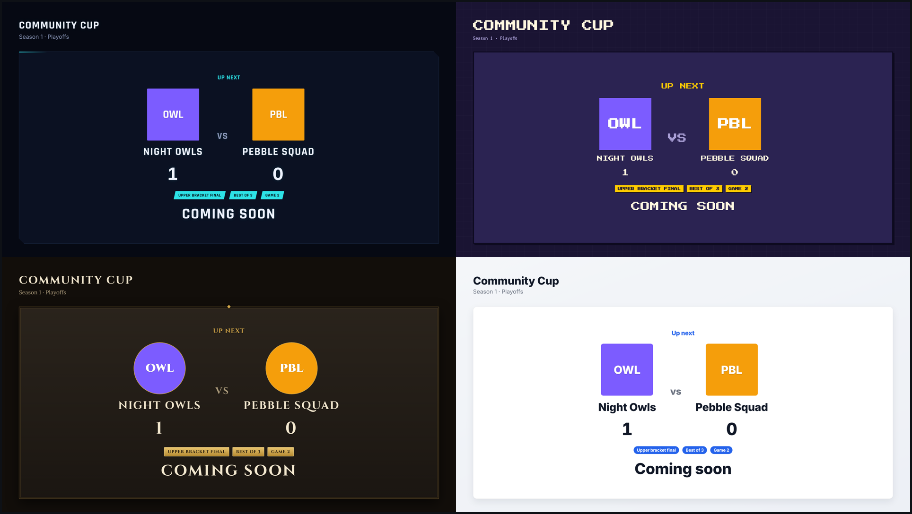
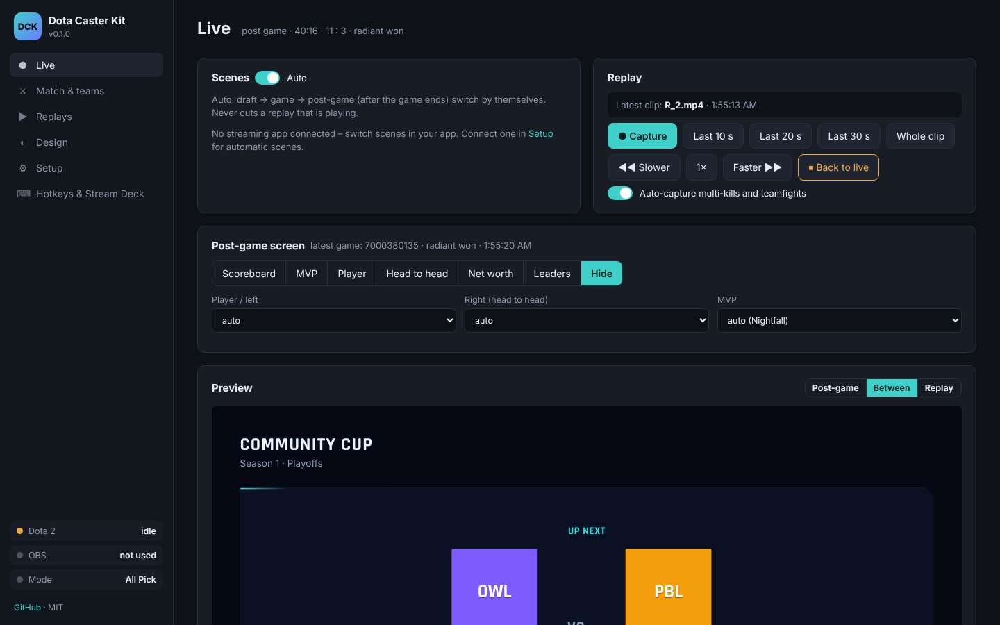

# Dota Caster Kit

**Free broadcast toolkit for amateur Dota 2 tournaments.** Post-game screens, instant replays and a between-games highlight reel – driven by Dota's own game data, styled by themes you can rebrand in minutes. Works with **OBS Studio** and **Streamlabs Desktop**.

Grew out of the stream tools of *Rumble in the Jungle*, a community Ability Draft tournament.

## What you get

| | |
|---|---|
| **Post-game screens** | Scoreboard (K/D/A, net worth, GPM/XPM, damage, items), MVP spotlight, player spotlight, head-to-head, net-worth graph, tournament leaders. One click each. |
| **Instant replays** | Save your replay buffer, then play the last 10 / 20 / 30 s or the whole clip at 0.25×–2× speed. Goes back to the game when it ends. |
| **Highlight reel** | Multi-kills and teamfights are detected from the game data and captured automatically. The between-games screen loops them next to *Up next*. When the next draft starts, the clips are filed into `Highlights/<date> <teams>/`. |
| **Series tracking** | Teams, logos, Bo1/2/3/5, score counted automatically from the winning side. |
| **Auto scenes** | Draft → game → post-game switch on their own (OBS / Streamlabs connection). Never cuts a replay. |
| **Themes** | 4 built-in themes. Upload your background, logo and texture (sizes are checked), override colours – or write your own theme with plain CSS. |
| **Stream Deck ready** | Every button is also a URL – Stream Deck, Bitfocus Companion, Touch Portal, AutoHotkey. |
| **All Pick or Ability Draft** | AD mode adds a live draft board and drafted abilities on every screen (needs [Ability Draft Plus](https://github.com/Tiarin-Hino/ability-draft-plus)). |

No accounts, no cloud, no npm install – one small Node.js app on the streaming PC, controlled from a browser panel:

## Quick start (Windows)

1. Install **Node.js** LTS from [nodejs.org](https://nodejs.org).
2. [Download this repo](https://github.com/Tiarin-Hino/dota-caster-kit/archive/refs/heads/main.zip) and unzip it.
3. Double-click **`start.bat`**. The control panel opens at <http://127.0.0.1:58900/>.
4. Follow the **Setup** tab (≈10 minutes): game mode → connect Dota → connect OBS/Streamlabs → replay folder → add the overlays.

Mac/Linux: `./start.sh` (the panel works the same; Dota GSI auto-install is Windows-only, use *Download file*).

No Dota running? Try everything with a fake game: `node tools/fake-gsi.js` (in a second terminal while the app runs).

## The overlays

Add each as a **Browser Source, 1920 × 1080**, in its own scene:

| Page | URL | Use |
|---|---|---|
| Post-game | `http://127.0.0.1:58900/overlays/postgame.html` | after the game; the panel picks the screen |
| Between games | `http://127.0.0.1:58900/overlays/between.html` | *Up next* + highlight reel (`?sound=1` for clip audio, `?reel=0` without reel) |
| Replay | `http://127.0.0.1:58900/overlays/replay.html` | plays the clip you pick (`?sound=1` for audio) |
| AD draft | `http://127.0.0.1:58900/overlays/draft.html` | Ability Draft only |

Any page takes `?theme=<id>` to preview another theme.

## All Pick vs Ability Draft

- **All Pick / Captains Mode / Turbo / anything with a normal draft** – everything works from Dota's game data alone.
- **Ability Draft** – Dota's spectator data mixes up which player drafted which ability. AD mode reads the real picks from **[Ability Draft Plus (AD+)](https://github.com/Tiarin-Hino/ability-draft-plus)**, which must run on the same PC. You get the AD draft board and drafted abilities on the scoreboard and MVP screens.

## Docs

- [Setup in detail](docs/SETUP.md) – OBS, Streamlabs, replay buffer, scenes, troubleshooting
- [Making a theme](docs/THEMES.md) – image sizes, CSS variables, a theme from scratch
- [Stream Deck & hotkeys](docs/HOTKEYS.md)
- [Contributing](CONTRIBUTING.md)

## Requirements

- Windows 10/11 (Mac/Linux work, minus the one-click GSI install)
- Node.js 18 or newer
- Dota 2, spectating or watching a replay on the streaming PC (that is when Dota sends all 10 players)
- OBS Studio 28+ or Streamlabs Desktop (optional – without them you switch scenes yourself)
- Internet on the streaming PC for hero/item/ability images (loaded from Valve's CDN)

## License

MIT – use it for your tournament, fork it, share your themes. Fonts are SIL OFL. Not affiliated with Valve; Dota 2 is a trademark of Valve Corporation.
